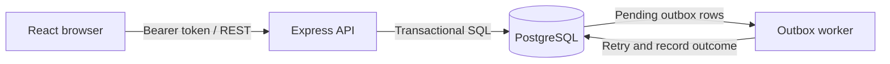

# Newtonite Ops — Operations Under Pressure

A team-scoped operations tracker for creating, assigning, and resolving work items with **workflow guardrails, server-side authorization, concurrency safety, and an auditable activity history**.

> **Project demo:** [▶ Watch the 3–5 minute Newtonite Ops walkthrough](https://drive.google.com/file/d/1UbL8oaPmMBS3dTyf898PjqMdwuH_R5uq/view)  
> The demo is shared for link-based viewing.

## At a glance

- **Frontend:** React + Vite
- **Backend:** Node.js + Express
- **Database:** PostgreSQL (pg)
- **Testing:** Jest + Supertest
- **Local environment:** Docker Compose

## What it demonstrates

| Capability | Implementation focus |
| --- | --- |
| Role- and team-aware access | API-side authorization based on team membership and role |
| Controlled work-item workflow | Server-validated state transitions and Lead approval |
| Safer concurrent updates | Version-based optimistic concurrency checks |
| Atomic claiming | Prevents multiple users from successfully claiming the same unassigned item |
| Idempotent creation | Supports the Idempotency-Key header for repeated create requests |
| Activity history and comments | Records item events and provides a timeline for review |
| Dashboard and listing | Status, priority, assignee and text filters, with cursor pagination |
| Asynchronous processing | Transactional outbox worker with retry handling |

## Run locally

### Prerequisites

- Docker Desktop (or Docker Engine) with Docker Compose
- Node.js 20+ only if running the API or UI outside Docker

### Start the application

```bash
cp .env.example .env
docker compose up --build
```

When the services are ready:

- **Web app:** http://localhost:5173
- **API health check:** http://localhost:4000/health

The API waits for PostgreSQL and initializes the schema and deterministic demo seed during startup.

To stop the services, press Ctrl+C if running in the foreground, or run:

```bash
docker compose down
```

## Demo accounts

All seeded accounts use the local-evaluation password demo12345.

| Email | Role | Team scope |
| --- | --- | --- |
| maya.member@newtonite.local | Member | Platform |
| liam.lead@newtonite.local | Lead | Platform |
| ava.viewer@newtonite.local | Viewer | Platform |
| noah.member@newtonite.local | Member | Payments |
| root.admin@newtonite.local | Admin | Platform and Payments |

These credentials are for local evaluation only. Do not use them for a public deployment.

## Run the tests

With the Compose stack running:

```bash
docker compose exec api npm test
```

Alternatively, run the API tests locally from the api directory with dependencies installed and DATABASE_URL configured:

```bash
cd api
npm install
npm test
```

The test suite covers critical API behaviors including workflow and authorization rules, idempotency, stale-version rejection, and concurrent claiming.

## API overview

| Method | Endpoint | Purpose |
| --- | --- | --- |
| POST | /auth/login | Authenticate a user |
| GET | /me | Get the current user |
| GET | /items?status=&priority=&assignee=&q=&teamId=&limit=&cursor= | List and filter work items |
| POST | /items | Create an item; supports Idempotency-Key |
| GET | /items/:id | Read an item |
| PATCH | /items/:id | Update an item using its version |
| POST | /items/:id/claim | Claim an unassigned item |
| POST | /items/:id/transition | Request a workflow transition |
| POST | /items/:id/comments | Add a team comment |
| GET | /items/:id/activity | Read item activity history |
| GET | /dashboard/summary | Get dashboard counts |

Item routes require a bearer token. Authorization is checked server-side against team membership and role.

## Architecture



## Engineering notes

- [Engineering decisions](ENGINEERING_DECISIONS.md) — design choices, alternatives, and trade-offs.
- [Known limitations](KNOWN_LIMITATIONS.md) — current scope and caveats.

## Scope and limitations

This is an interview-challenge project, not a production-ready incident-management system. It intentionally omits email delivery, attachments, SSO, WebSockets, and mobile support. Review the known limitations before evaluating or extending the application.
