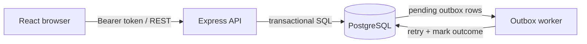

# Operations Under Pressure — Newtonite Ops

A team-scoped operational work-item tracker built around correctness, not just CRUD. It includes role-aware access, guarded workflow transitions, optimistic concurrency, idempotent creation, append-only activity, cursor pagination, and a transactional outbox worker.

## Stack
- API: Node.js, Express, PostgreSQL (`pg`)
- UI: React + Vite
- Tests: Jest + Supertest
- Local infrastructure: Docker Compose

## Prerequisites
Docker Desktop / Docker Engine with Compose, and Node.js 20+ (only needed if running API/UI outside Docker).

## Start
```bash
cp .env.example .env
docker compose up --build
```
- UI: http://localhost:5173
- API health: http://localhost:4000/health

The API waits for PostgreSQL and creates the schema + deterministic demo seed on startup.

## Demo users
Password for all seeded users: `demo12345`
- `maya.member@newtonite.local` — Member, Platform team
- `liam.lead@newtonite.local` — Lead, Platform team
- `ava.viewer@newtonite.local` — Viewer, Platform team
- `noah.member@newtonite.local` — Member, Payments team
- `root.admin@newtonite.local` — Admin, Platform + Payments teams

Login from the UI or use `POST /auth/login` with `{ "email": "...", "password": "demo12345" }`.
Demo credentials are for local evaluation only. Replace them before any public deployment.

## API overview
- `POST /auth/login`
- `GET /me`
- `GET /items?status=&priority=&assignee=&q=&teamId=&limit=&cursor=`
- `POST /items` (supports `Idempotency-Key`)
- `GET /items/:id`
- `PATCH /items/:id` (requires `version`)
- `POST /items/:id/claim`
- `POST /items/:id/transition` with `{ "to": "IN_PROGRESS" }`
- `POST /items/:id/comments`
- `GET /items/:id/activity`
- `GET /dashboard/summary`

All item routes require a bearer token. Access is checked on the server against team membership and role.

## Tests
```bash
cd api
npm install
npm test
```
Tests include API workflow/authorization/idempotency/stale-version checks. They require a running PostgreSQL database; set `DATABASE_URL` accordingly. The concurrency claim test is designed to prove that only one claimant wins.

## Design notes
Read [ENGINEERING_DECISIONS.md](ENGINEERING_DECISIONS.md) for assumptions, alternatives and trade-offs. See [KNOWN_LIMITATIONS.md](KNOWN_LIMITATIONS.md) before evaluating.

## Architecture


## Safety and scope
This is an interview challenge project, not a production-ready incident-management system. It intentionally omits email delivery, attachments, SSO, WebSockets, and mobile support.
